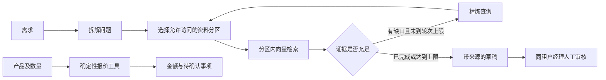

# 售前研究与选配报价助手

把售前问题拆为检索任务，在调用者权限范围内查资料、检查缺口、整理带来源的草稿，再由人员审核。报价工具从模拟目录读取单价，用代码计算金额，不让模型填写价格或授予权限。

这是 **2026 年 10 月在 AI 辅助下新建的实习相关能力重建演示**，不是公司原始源码或生产系统。星桥品牌、24 个产品、80 份资料及 200 条评测均为新制合成材料，不含原公司的客户数据。当前测量结果不代表原实习的历史业务成绩。


## 已实现

| 环节 | 实现 |
|---|---|
| 研究流程 | LangGraph：拆解 → 并发派发检索 → 证据检查 → 缺口扩展 → 汇总；最多 2 轮 |
| 检索 | BGE 中文向量；PostgreSQL/pgvector；按租户和角色分区，每个可访问分区建立 HNSW 索引，再合并前五结果 |
| 三层兜底 | 限制输入、查询数、轮次和输出长度；模型/检索失败自动降级；草稿进入人工审核 |
| 工具 | 官方 MCP Python SDK 暴露 `search_knowledge` 与 `create_quote`，HTTP 请求验证 JWT |
| 配单 | 固定目录价、整数分计算、折扣审批提示、库存/预算检查、基础交换机与 AP 兼容提示 |
| 过程展示 | FastAPI + SSE + 原生网页；SQLite 留存运行、事件和经理审核决定 |
| 监控 | Prometheus 模型耗时、输入/输出 token、降级、鉴权拒绝及检索计数；本地模式付费 API 成本为零 |



## 先运行基础演示

在 Windows Python 3.13 上完成验证。首次安装需要网络和模型下载空间；已有缓存可以离线使用。以下命令在仓库目录执行，不要求激活 PowerShell 脚本。

```powershell
python -m venv .venv
.\.venv\Scripts\python.exe -m pip install -r requirements.txt
.\.venv\Scripts\python.exe run.py
```

打开 http://127.0.0.1:8128 。默认是**资料摘录模式**，使用真实 BGE 向量模型、内存精确检索，不调用生成式模型或付费 API。它用于先检查页面、配单和工作流，不能称为 HNSW 模式。

## 使用 PostgreSQL 与 HNSW

本机无需安装 Docker 或系统服务。Node.js 下的 PGlite 提供 PostgreSQL/WASM、pgvector 扩展及本地 TCP 接口；Python 使用同一套 psycopg/SQL 查询。

```powershell
npm ci
.\.venv\Scripts\python.exe scripts/start_demo.py
```

启动器打开浏览器，并在退出时只停止自己创建的子进程。Windows 也可双击 `start_demo.cmd`。若已启动基础演示，先在其终端按 Ctrl+C 退出，避免占用 8128 端口。

有现成 PostgreSQL/pgvector 开发库时，可设置 `PRESALES_DATABASE_URL` 后运行 `run.py`。启动会重建本项目 `presales_documents` 表的合成内容，因此应使用专用开发库。

## 可选本地生成模型

```powershell
$env:PRESALES_MODEL_MODE = 'local'
.\.venv\Scripts\python.exe scripts/start_demo.py
```

默认加载 `Qwen/Qwen3-4B-Instruct-2507`，首次需下载模型；验证机器为 RTX 4070 Ti。它在拆解和汇总时实际生成文本。生成失败或引用检查失败时保留资料摘录结果，并在过程记录中显示降级。默认启动不加载此模型；项目没有自动选择付费云模型的分支。

配置项见 [.env.example](.env.example)。文件不会被隐式加载，请在终端设置环境变量。

## 重现验证

```powershell
.\.venv\Scripts\python.exe -m pytest -q
# 另一个终端运行 npm run db，或已通过 start_demo.py 启动本地数据库
$env:PRESALES_DATABASE_URL = 'postgresql://postgres@127.0.0.1:55432/postgres?sslmode=disable'
.\.venv\Scripts\python.exe scripts/evaluate.py
# 应用正在运行时：用官方 MCP 客户端和 HTTP/SSE 做完整检查
.\.venv\Scripts\python.exe scripts/smoke_live.py
```

当前记录：

| 验证 | 结果与口径 |
|---|---|
| 自动测试 | 26 项：鉴权、检索前 ACL、金额/边界、降级、持久记录、审核、SSE 与 MCP |
| 200 条基础评测 | 160 条可回答检索题 Recall@5 为 160/160；40 条越权攻击题没有返回受限资料 |
| 索引 | 实际建立 pgvector HNSW 索引，并用 EXPLAIN 验证索引路径；小表默认可能使用顺序扫描 |
| 完整联调 | 本地 Qwen 生成、HTTP、SSE 最终事件、官方 MCP 客户端、报价 2850.00 元、跨租户拒绝和经理审核通过 |
| 网页 | 桌面 1440×1100、手机 390×844；无横向溢出和页面脚本错误 |
| 启动器 | 实际启动数据库及应用，验证健康接口；模拟中断后两个端口均已关闭 |

原始记录：[检索逐题结果](results/retrieval_20261024.json)、[完整联调](results/live_smoke_20261024.json)、[网页检查](results/browser_qa_20261024.json)、[启动器检查](results/launcher_qa_20261024.json)。

**这些题来自同一套小型模拟资料，包含模板改写，100% 的基础命中不代表真实客户泛化能力。** Recall@5 只衡量资料是否进入前五，不是选型准确率或生成回答正确率。引用校验只验证来源 ID 属于检索结果，不能替代逐句事实核对。PGlite 也不等于生产 PostgreSQL 的并发、可用性或性能验证。

## 演示与阅读

先看 [五分钟演示与代码导览](docs/演示与代码导览.md)，再看 [重建范围](docs/重建范围.md)。

本机演示入口允许选择模拟身份，JWT 是预发演示令牌，**没有实现完整 OAuth 登录服务**；MCP 运行在 Streamable HTTP 上。API 只绑定回环地址。部署到共享环境前必须关闭演示身份入口，并接入真实身份来源；当前版本按本机演示交付。

MIT 许可仅覆盖本仓库新建内容；依赖、模型及其各自许可仍归相应权利人。实现依据：[pgvector](https://github.com/pgvector/pgvector)、[MCP Python SDK v1](https://py.sdk.modelcontextprotocol.io/v1/)、[PGlite Socket](https://pglite.dev/docs/pglite-socket)、[LangGraph](https://docs.langchain.com/oss/python/langgraph/graph-api)。
