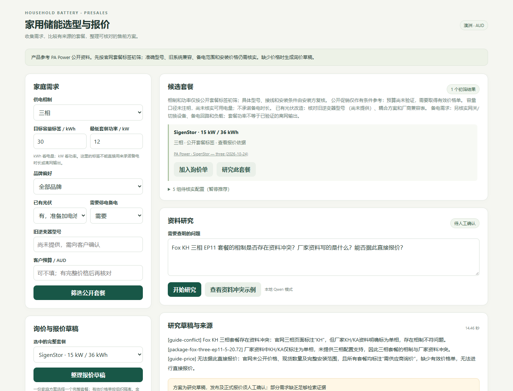
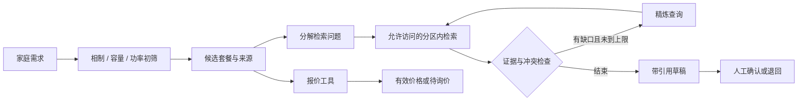
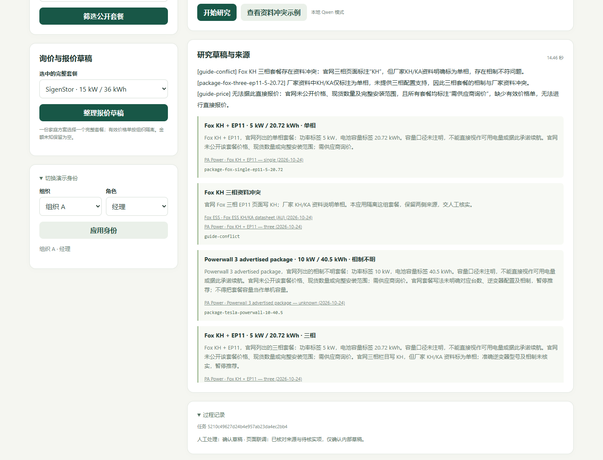

# 家用储能选型与报价助手

为“已有光伏的家庭想加电池”整理售前方案：收集相制、容量和功率需求，筛选公开套餐，检索来源、检查冲突，再生成待人工确认的研究与报价草稿。



产品事实参考 [PA Power 产品页](https://papower.com.au/products)，核对日期 **2026-10-24**。20 组公开套餐中，15 组可作初筛候选，5 组因来源冲突或配置歧义暂停推荐。保留原品牌、原始数值和来源，不把套餐标签当成完整电气设计。公开资料引用不表示与供应商存在合作关系；不包含原公司的源码、客户或订单数据。

价格来源补充于 **2026-10-25**：[PA Power 关联账号的三相促销帖](https://www.ozbargain.com.au/node/977206)列出 HYXI E200 + HYX-H10K-HT（21.2 kWh / 10 kW）AUD 3157 条件价。须在 2026-11-01 前安装，并核实优惠资格、勘测、库存和额外费用。系统不将它套用到不同型号或单相套餐；安装窗口结束后停止提供该参考金额。

## 一次完整流程

1. 输入家庭相制、最低容量标签和套餐功率、品牌偏好、旧光伏及备电需求。
2. 确定性代码筛选候选，列出原始来源。相制未知先澄清；旧逆变器兼容、备电回路与网关交安装方核实。
3. 研究图拆解问题、派发检索、检查证据和缺口，最多补查一轮，再整理带引用的草稿。
4. 从一个完整套餐生成询价/报价草稿。有来源的公开条件价单独显示，客户资格和安装范围未核实时，最终金额仍为 `null`。配置有效私有价格单后，分别处理设备小计、含税安装价、有效期和预算。
5. 同组织经理填写意见并确认或退回草稿，过程留存；不会向供应商发送表单、报价、消息或订单。



## 关键实现

| 能力 | 实现 |
|---|---|
| 家庭选型 | 相制、容量、功率、品牌筛选；冲突隔离；不自动拼接跨品牌系统 |
| Deep Research | LangGraph：拆解 → 并行检索 → 证据检查 → 缺口精炼 → 汇总，最多两轮；原生 PostgreSQL 独立连接并行，PGlite 自动识别并串行 |
| 三层处理 | 输入/轮次/队列限制；模型与检索异常降级；草稿人工确认 |
| 检索与权限 | BGE 向量 + pgvector/HNSW、BM25、RRF 融合及 BGE 重排；两路均先限制租户/角色，再召回和排序 |
| 持久化 | LangGraph SQLite 节点检查点；重启后原身份可恢复中断任务；另存事件和审核记录 |
| MCP 工具 | 官方 SDK：`search_knowledge`、`select_battery`、`create_quote`；JWT 身份来自验证后的令牌 |
| 过程和监控 | SSE、来源链接、运行 Trace；Prometheus 记录实际 token/延迟、按配置费率估算的成本、降级率、HTTP 拒绝率及独立的检索越权记录率 |
| 报价 | AUD、整数澳分；价格按组织隔离；过期作废；公开条件价、部分费用及含税安装总价分开 |



## 在 Windows 运行

已验证 Python 3.13、Node.js、Windows。首次安装需要网络和模型下载空间。

本地模型加载所需的 `accelerate` 已列入 requirements。2026-10-25 用新的独立虚拟环境安装全部依赖，验证新增的 jieba/BM25 依赖与测试，见 [本次安装记录](results/installation_20261025.json)。原微型 Qwen3 加载/前向计算验证见 [前次记录](results/installation_20261024.json)。默认包源提供 CPU 版 PyTorch；完整本地 Qwen 的既有 GPU 联调使用另行安装的 CUDA 版本。

```powershell
python -m venv .venv
.\.venv\Scripts\python.exe -m pip install -r requirements.txt
npm ci
.\.venv\Scripts\python.exe scripts/start_demo.py
```

也可双击 `start_demo.cmd`。启动器打开 http://127.0.0.1:8128 ，退出时停止它自己创建的进程。默认使用本地 PGlite/PostgreSQL + pgvector/HNSW、BGE 向量/BM25/重排和资料摘录，无需付费模型 API。

如暂不安装 Node，直接运行 `run.py`，且不设 `PRESALES_DATABASE_URL`，会采用内存向量 + BM25 + 重排；这个模式不称为 HNSW。已有 PostgreSQL/pgvector 时可设置自己的 `PRESALES_DATABASE_URL`，**请使用专用开发库**：启动会重载本项目 `presales_documents` 表。

真正的 SQL 并行使用原生 PostgreSQL；每个检索任务使用独立连接，PGlite 才使用串行锁。启动器保留外部设置的数据库地址。实际多连接验证见 `results/parallel_postgres_20261024.json`：三个不同后端连接的 SQL 执行区间重叠。该验证注入 `pg_sleep(0.3)` 检查并行性，耗时不是生产查询性能。

成本默认按本地模式记零；如有明确计价费率，可配置 `PRESALES_INPUT_CNY_PER_MILLION` / `PRESALES_OUTPUT_CNY_PER_MILLION`，按实际输入/输出 token 计算并记录到 Trace 和 Prometheus。这是费率估算，不冒充供应商账单。检索额外独立核验返回记录的租户和角色，异常记录阻断后计入越权分子，以全部核验记录为分母。

可选本地 Qwen 生成：

```powershell
$env:PRESALES_MODEL_MODE = 'local'
.\.venv\Scripts\python.exe scripts/start_demo.py
```

默认生成模型是 `Qwen/Qwen3-4B-Instruct-2507`，需要相应内存/显存。它参与拆解和成文；失败或引用 ID 检查不通过则自动退回资料摘录。模型不能设置价格、租户或角色。项目只提供本地与摘录两种模式，没有自动调用付费云 API 的分支。

配置见 [.env.example](.env.example)，文件不会被隐式加载。一组精确匹配的 HYXI 三相套餐有公开条件价；获得供应商价格单后，可按 [数据与来源](docs/数据与来源.md) 设置 `PRESALES_PRICEBOOK`。不要把私有价格单提交到仓库。

## 实际验证

| 验证 | 当前结果 |
|---|---|
| 自动测试 | 39 项通过，包含双路权限、重排异常、公开价型号匹配/安装窗口/私有价优先，以及价格状态/有效期/预算、冲突隔离、JWT、检索前 ACL、独立越权阻断/计数、非零费率成本计算、异常降级、SSE、MCP、进程中断模拟及 API 恢复 |
| 资料检索 | 200 条新编选型资料题，目标来源 Recall@5 为 200/200 |
| 越权 | 另设 40 条攻击题；全部 240 次检索的返回内容中，越权记录为 0 |
| 数据库 | 实际创建 pgvector HNSW 索引，并用 EXPLAIN 验证索引路径 |
| 完整联调 | 实际本地 Qwen、HTTP/SSE、官方 MCP 客户端三个工具、空价处理、跨组织拒绝及人工审核通过 |
| 页面 | 1440×1100 桌面与 390×844 手机；无横向溢出及脚本错误；身份切换清除先前无权读取的结果 |

最新混合检索逐题结果见 [2026-10-25 记录](results/battery_hybrid_retrieval_20261025.json)，旧纯向量结果保留。逐题及联调记录在 [results](results/)；其中每个文件标有测量时间和口径。这些是本次公开资料版本的新测试，不是历史实习业务统计。200 条题与小型资料库同源，包含模板改写，100% 命中不能解释为真实客户泛化能力、推荐准确率或回答事实正确率。

```powershell
.\.venv\Scripts\python.exe -m pytest -q
# 先用另一个终端运行 npm run db，或已通过启动器开启数据库
$env:PRESALES_DATABASE_URL = 'postgresql://postgres@127.0.0.1:55432/postgres?sslmode=disable'
.\.venv\Scripts\python.exe scripts/evaluate.py
# 使用原生 PostgreSQL 时验证独立连接的实际并行
.\.venv\Scripts\python.exe scripts/verify_parallel.py
# 应用运行时检查 HTTP、SSE 和官方 MCP 客户端
.\.venv\Scripts\python.exe scripts/smoke_live.py
# 可选网页检查，需要已安装 Playwright 和 Edge
node scripts/browser_check.cjs
```

更多讲解：[五分钟演示与代码导览](docs/演示与代码导览.md)、[数据与来源](docs/数据与来源.md)。

当前 BM25 每次仅在授权小目录内建索引，重排在 CPU 上串行执行；这适用于本地演示，不是大规模并发实现。

本机演示入口可切换模拟身份；JWT 为预发令牌，未实现完整 OAuth 或企业登录。API 只监听回环地址。PGlite 单连接执行 SQL，不代表生产并发/高可用；小表默认也可能走顺序扫描。引用检查验证 ID 属于检索结果，逐句事实仍需人员核对。电气设计、施工合规、实时价格/库存、补贴及回本测算应另行取得有效资料。

MIT 覆盖新代码及新编说明；第三方依赖、模型与引用资料保留各自权利。实现参考：[pgvector](https://github.com/pgvector/pgvector)、[MCP Python SDK v1](https://py.sdk.modelcontextprotocol.io/v1/)、[LangGraph](https://docs.langchain.com/oss/python/langgraph/persistence)、[PGlite Socket](https://pglite.dev/docs/pglite-socket)。
